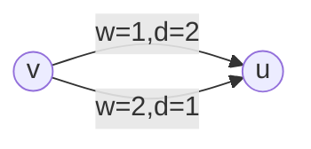

# Depth first label setting

[Label setting](Labeling.md) is one of the standard exact methods for the constrained shortest path problem (CSP): it combines repeatedly expanding labels along edges as representation of partial source-to-node paths and pruning to discard labels that cannot participate in an optimal feasible solution.

This document zooms in on the algorithms implemented in this code base that expand labels in a depth first ordering. Let Q be a stack of candidate labels. Initialize Q with a label $(0,0)$ at the source $s$. Then each time the newest element in Q is selected and expanded along all outgoing edges. New labels are added to the top of the stack Q.

```text
1  Stack Q = {(0,0,s)}
2  while Q not empty:
3    Label l(w,d,v) = pop top of Q
4    if l not pruned:      // post-expansion
5      for all edges e out of v:
6        Let u = successor at head of e
7        Let l` = new label (w + w(e), d + d(e), u)
8        if l` not pruned: // pre-expansion
9          push l` onto Q
10     // post-recursion
```

Algorithms in this category differ in which pruning rules are applied. See [Pruning](Labeling.md#pruning) for an overview. And they differ when pruning is applied: pre-expansion pruning happens before a new label is pushed onto the stack (line 8), post-expansion after a label is popped from the stack and before it is treated (line 4). Post-recursion code executes after the entire subtree below has returned (line 10).

## Reference algorithms

Examples from the literature on which we based our reference algorithms are:

### Pulse algorithm

The Pulse algorithm [Lozano and Medaglia, 2013] is based on a recursive depth-first search. It exploits three pruning strategies to avoid complete exploration of the solution space: feasibility, weight bound and dominance.

post-expansion:

```text
if label l not dominated:
  add label l to non-dominated set
```

pre-expansion:

```text
if label l' is feasible:
  if label l' weight bound: 
```

Note: the original Pulse algorithm as described in [Lozano and Medaglia, 2013] limits the size of the non-dominated label set stored at each node and describes rules for which labels to remove from the storage when that limit would otherwise be exceeded. This is not part of our implementation, we store all non-dominated labels at each node.

### Lagrangian Relaxation and Enumeration

Lagrangian Relaxation and Enumeration (LRE) [Carlyle et al., 2008] is based on near shortest path enumeration [Carlyle and Wood, 2005], [Byers and Waterman, 1984]. It expands partial paths in a depth-first search order and prunes on feasibility, weight bound and Lagrangian bound.

post expansion:

```text
if label l within Lagrangian bound:
  if label l within weight bound:
    if label l feasible:
```

## Completion equivalence pruning

Dynamic programming is a long established technique to solve the constrained shortest path problem [Joksch, 1966]. Label setting is sometimes still called dynamic programming.

The connection between dynamic programming and decison diagram (DD) compilation is also well known. See [Bergman et al. 2016] for a comprehensive overview. A decision diagram for a knapsack constraint can be build by running dynamic programming on the state-space as if you would solve the knapsack problem. The acyclic state-transition graph of the dynamic programming table is a binary decision diagram: it encodes all feasible solutions as paths on the graph. However, it is not a minimal decision diagram. An additional bottom-up minimization of the graph is required to detect and merge isomorphic subgraphs. [Behle, 2007] proposed an output-sensitive decision diagram compilation which constructs a minimized decision diagram in one depth first traversal.

Define the label transition graph as the graph emerging from applying label setting to the constrained shortest path problem. Each label that is not pruned is a node and the label expansions define the edges of the graph. This label transition graph encodes the subspace of efficient paths on the original graph. As with decision diagrams, the label transition graph is not minimal. Isomorphic subgraphs exist, in other words: more than one label has explored the same state-space. This hints at an opportunity to reduce the amount of label expansions.

The completion equivalence pruning we propose is an extension of the output-sensitive compilation technique of [Behle, 2007] to the weight constrained shortest path problem.

### Delay completion equivalence

A direct translation could be described as: for every label $l=(w(p_{s \rightarrow v}),d(p_{s \rightarrow v}))$ arriving at a node $v$ during depth first traversal, an interval $[L,U)$ can be derived after the label has been expanded to all successors and before backtracking. Any future label $l'$ whose delay $d(p'_{s \rightarrow v})$ falls inside the interval: $L \leq d(p'_{s \rightarrow v}) \lt U$ has equivalent delay completion to label $l$. I.e. the subgraph of feasible completions from node $v$ to the terminal $t$ is isomorphic for all delays in the range $[L,U)$. This means that the shortest weight over this isomorphic subgraphs is also identical. We define the completion weight of an interval as the weight of the shortest delay-feasible path from its node to the terminal for a label whose delay lies within the interval's bounds $[L,U)$.

This gives the following algorithm:

initialization:

```text
// initialize every node with an interval that captures infeasible 1 1 partial paths
2 for every node v:
3   insert interval [D - least_delay_to_terminal[n] + 1, +inf) with completion weight +inf
4 for the terminal:
5   insert interval [-inf, D + 1) with completion weight 0
```

Note: we use `+ 1` for the interval bounds, which is correct for integer delays. For the none integer case, a small $\epsilon$ could be used which should be $0 \lt \epsilon$ and smaller than the smallest non-zero delay of any edge.

post-expansion:

```text
if delay of label l falls into an existing interval at node:
  return
```

After having expanded to all successors along all edges, a new interval is created and added to the set of intervals at the node:

post-recursion:

```text
add interval [L,U) with completion weight W to the set of intervals, where:

W = min over all edges(successor completion weight + edge.weight)
U = min over all edges(successor U - edge.delay)
L = max over all edges(successor L - edge.delay)
```

The solution is the completion weight of the interval returned for label (0,0) at the source.

By analogy to [Behle, 2007] the label transition graph emerging from this algorithm is an exact and minimal represenation of all feasible paths for the constrained path problem.

### Weight completion equivalence

In the context of weight minimization, we can further strengthen the equivalence bounds $[L,U)$ by the following observation: for a minimal weight path, we are only interested in cases where the minimal weight completion to the terminal changes. I.e. it could be that below $L$ the feasible subgraph changes because more paths become feasible, but when these paths do not offer a better weight we don't really care. Reversely, it could be that above $U$ certain paths become infeasible, changing the feasible subgraph, but if the shortest weight path is still feasible we don't really care. So we derive stronger bounds, i.e. wider intervals, by setting $U$ to the delay at which the shortest weight completion to terminal becomes infeasible and $L$ to the delay below which a shorter weight completion to terminal becomes feasible.

replace the post-recursion interval derivation with:

```text
add interval [L,U) with completion weight W to the set of intervals, where:

W = min over all edges(successor completion weight + edge.weight)
U = (successor U - edge.delay) for successor that yielded min over all edges(successor completion weight + edge.weight)
L = max over all edges(successor L - edge.delay | (successor - 1).completion weight + edge.weight < W)
```

Intervals in this variant are not static. The lower bound $L$ may initially be inaccurate and is later superseded by a smaller $L$ (while $U$ stays the same). This happens when a successor interval has no predecessor yet — no label with a lower delay has visited that successor — in which case the unconstrained shortest weight to terminal is used as an estimate of the preceding interval's completion weight. This estimate is a lower bound; if it turns out to be too optimistic, the initial $L$ is set too high and is corrected downwards when a later label recomputes the interval with the now-known predecessor.

A worked out example can be found in the [example](examples/Labeling-DFS.md#Completion%20equivalence) directory.

## Backward dominance pruning

The traditional dominance pruning maintains a set of non-dominated labels at each node. New labels that arrive at this node are compared to the existing set for dominance. If dominated by at least one label in the set, the new label is not expanded further. If not dominated by any label in the set, the new label is added to the set and expanded further along outgoing edges.

We propose a stronger dominance by the following observation: if label $l=(w(p_{s \rightarrow v}),d(p_{s \rightarrow v}))$ at node $v$ is expanded to successor node $u$ along edge $e$ and is dominated at node $u$ by dominator $(w',d')$, then any label at node $v$ that is dominated by $(w' - w(e_{vu}), d' - d(e_{vu}))$ will be dominated by $(w',d')$ at node $u$. Since domination at node $u$ means: $w(p_{s \rightarrow v}) + w(e_{vu}) \ge w'$ and $d(p_{s \rightarrow v}) + d(e_{vu}) \ge d'$, we can say that $w' - w(e_{vu}) \le w(p_{s \rightarrow v})$ and $d' - d(e_{vu}) \le d(p_{s \rightarrow v})$. So the pair $(w' - w(e_{vu}), d' - d(e_{vu}))$ gives a stronger bound than the original label $(w(p_{s \rightarrow v}),d(p_{s \rightarrow v}))$.

In case of multiple outgoing edges, we need to make sure that future labels will be dominated along all edges. In a DFS ordering, all successors are visited before backtracking. This makes it possible to gather all successor dominators along all edges before constructing a dominator to be added to this node's set for future dominance pruning. To ensure future labels dominated by dominator $(w,d)$ are guaranteed to be dominated along all expansions somewhere in the subgraph rooted at node $v$, the dominator is constructed as the piecewise maximum:

post recursion:

```text
dominator.weight = max over all edges(successor dominator.weight - edge.weight)
dominator.delay = max over all edges(successor dominator.delay - edge.delay) 
```

An example: given two edges with (weight,delay) $(1,2)$ and $(2,1)$ from node $v$ to node $u$. Label $(3,5)$ at node $v$ is expanded to node $u$ as $(4,7)$ and $(5,6)$. Say node $u$ already has a pair $(1,2)$ that dominates both $(4,7)$ and $(5,6)$. Then we know that any label dominated by $(0,1)=(\max(1-1, 1-2), \max(2-2, 2-1))$ at node $v$ will be dominated at node $u$. So we can store $(0,1)$ at node $v$ instead of the label itself $(3,5)$ to prune future labels arriving at node $v$.



The terminal case ends the recursion: at the terminal, the label itself is stored whenever it is not dominated by the labels already in the storage.

Two special cases are added to accommodate feasibility and weight bound pruning:

- *feasibility*: every node is initialized with (weight, delay) pair $(-\infty, D - \underline{d}(p_{v \rightarrow t}) + 1)$ in its dominator set.
- *weight bound*: additionally, a label can be dominated by $(\overline{w}(p_{s \rightarrow t}) - \underline{w}(p_{v \rightarrow t}),-\infty)$ which is used as dominator for labels exceeding the weight bound.

Note: we use `+ 1` for the feasibility dominator, which is correct for integer delays. For the none integer case, a small $\epsilon$ could be used which should be $0 \lt \epsilon$ and smaller than the smallest non-zero delay of any edge.

We calculate the dominator after all expansions. When multiple edges visit the same successor, a dominator inserted during one edge's recursion may be superseded by a stronger one when the other edge visits the same successor. This is especially important to handle the case when edges visiting the successor dominate each other: $w(e_{vu}) \le w(e'_{vu})\ and\ d(e_{vu}) \le d(e'_{vu})$.

A worked out example can be found in the [example](examples/Labeling-DFS.md#Dominance%20vs.%20backward%20dominance) directory.

## Future work

- Combine completion equivalence pruning with pruning on the weight dimension (enabling pruning by backward dominance, weight bound and\or Lagrangian bound)
- explain and implement bidirectional variant (biPulse, [Cabrera et al., 2020]) for comparison
- Extend to general graphs and elementary path version with cycle detection
- Connection between label transition graph and a 'decision diagram' that encodes all feasible paths of the constrained shortest path problem. Opportunity for further 'cross node' reduction and canonical weights [Hooker, 2013].
- Extension to multiple resource constraints

## References

Behle M. (2007). On threshold BDDs and the optimal variable ordering problem. In: Dress, A., Xu, Y., Zhu, B. (eds) Combinatorial Optimization and Applications. COCOA 2007. Lecture Notes in Computer Science, vol 4616. Springer, Berlin, Heidelberg. https://doi.org/10.1007/978-3-540-73556-4_15

Bergman, D., Cire, A.A., Van Hoeve, W.J., & Hooker, J.N. (2016). Decision diagrams for optimization (Vol. 1). New York, NY: Springer International Publishing. https://doi.org/10.1007/978-3-319-42849-9

Byers T.H. and Waterman M.S. (1984). Determining all optimal
and near-optimal solutions when solving shortest path prob-
lems by dynamic programming, Operat Res 32 (1984),
1381–1384. https://doi.org/10.1287/opre.32.6.1381

Cabrera N., Medaglia A.L., Lozano L., Duque D. (2020). An exact bidirectional pulse algorithm for the constrained shortest path. https://doi.org/10.1002/net.21960

Carlyle M.W., Royset J.O. and Wood K.R. (2008), Lagrangian relaxation and enumeration for solving constrained shortest-path problems†. Networks, 52: 256-270. https://doi.org/10.1002/net.20247

Carlyle M.W. and Wood K.R. (2005), Near-shortest and K-shortest simple paths. Networks, 46: 98-109. https://doi.org/10.1002/net.20077

Hooker J.N. (2013). Decision Diagrams and Dynamic Programming. In: Gomes, C., Sellmann, M. (eds) Integration of AI and OR Techniques in Constraint Programming for Combinatorial Optimization Problems. CPAIOR 2013. Lecture Notes in Computer Science, vol 7874. Springer, Berlin, Heidelberg. https://doi.org/10.1007/978-3-642-38171-3_7

Joksch H. (1966). The Shortest Route Problem with Constraints. Journal of Mathematical Analysis and Application, 14, pp. 191–197. https://doi.org/10.1016/0022-247X(66)90020-5

Lozano L., Medaglia A. L. (2013). On an exact method for the constrained shortest path problem Computers & Operations Research, Volume 40, Issue 1, Pages 378-384, https://doi.org/10.1016/j.cor.2012.07.008.