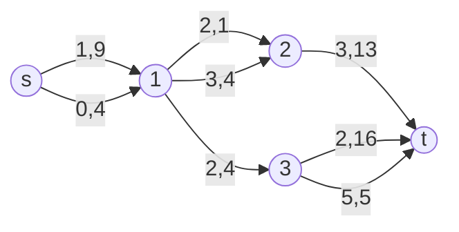
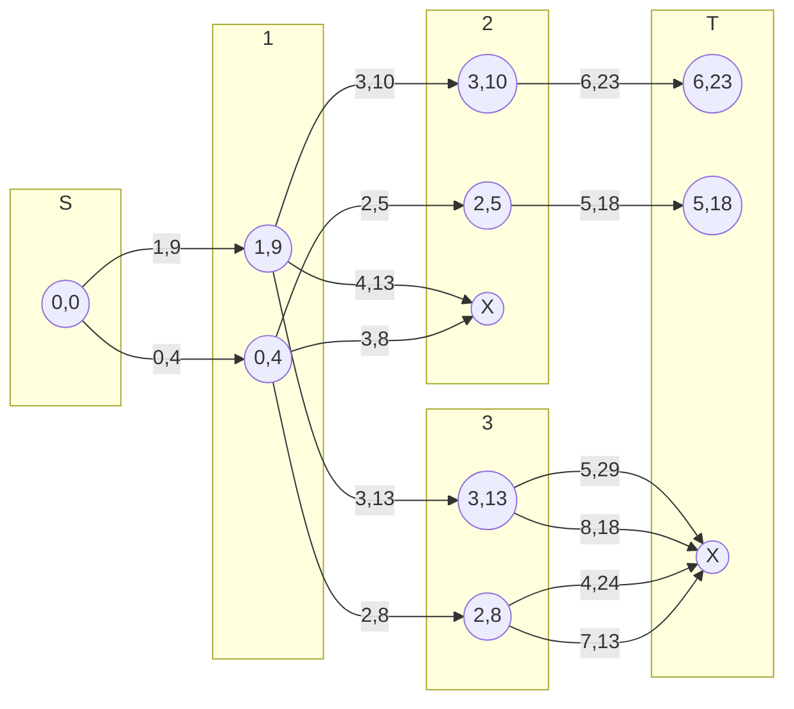
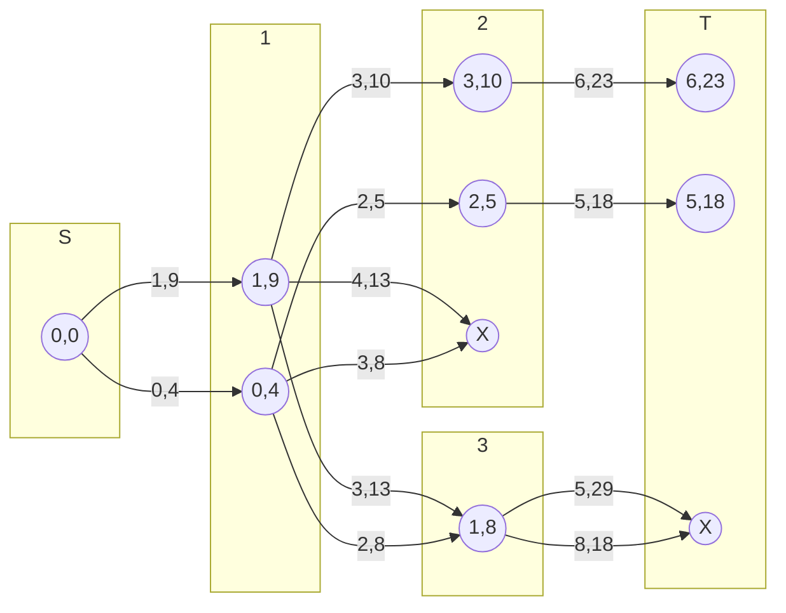
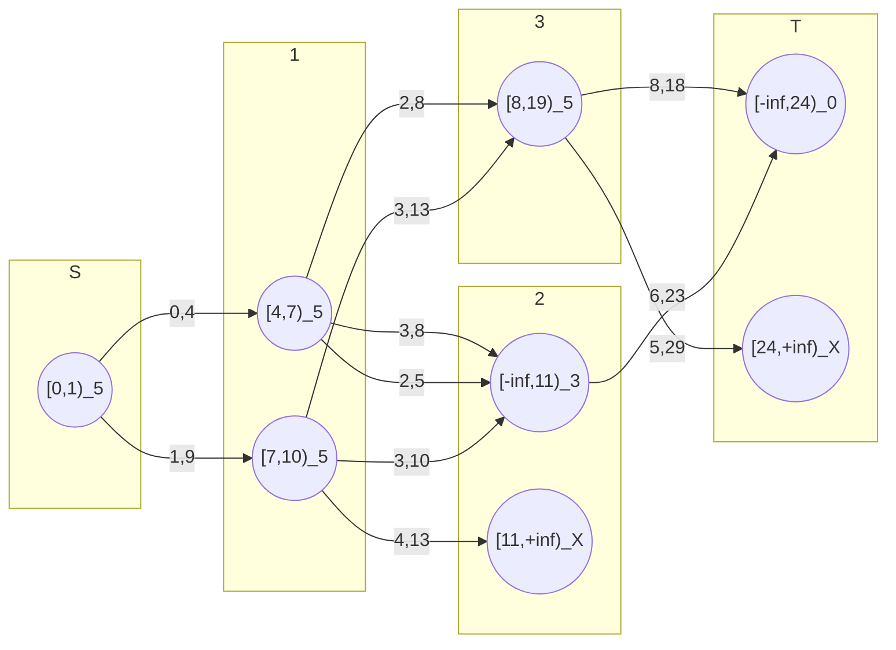
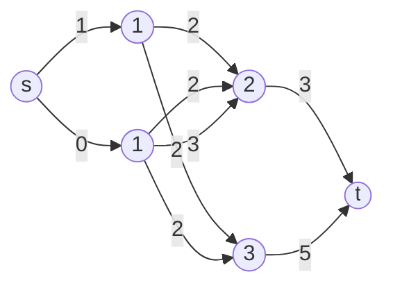
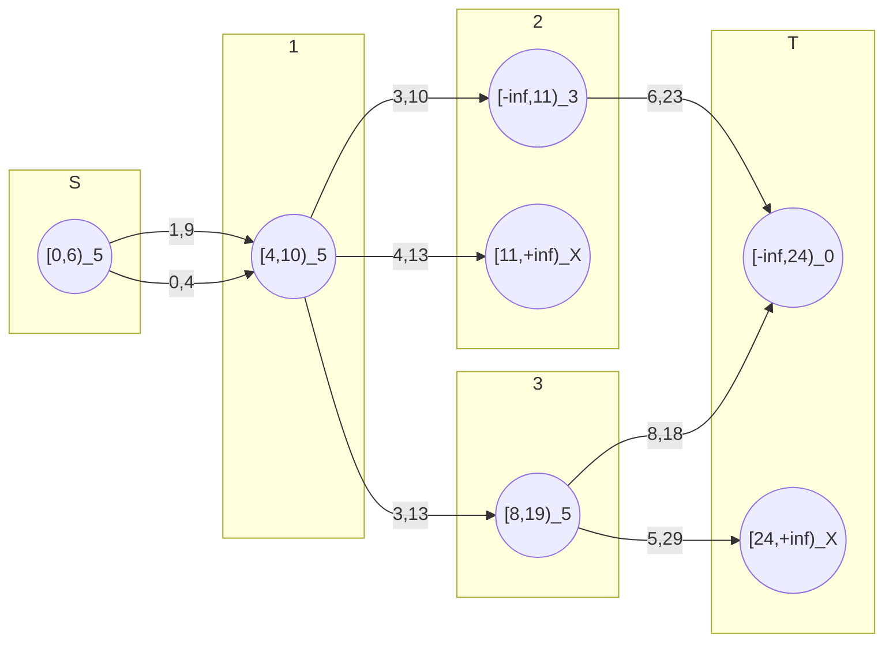

# Example 1

We'll use the following example in which edges are annotated with $(weight,delay)$ pairs and the delay constraint limit we use is $D = 23$:

The least delay path goes via the $(0,4)$ edge, over nodes 1 and 3, along edge $(5,5)$ and has a delay of $13$ and a weight of $7$. The shortest weight path also goes via the $(0,4)$ edge, over nodes 1 and 3, but ends with the $(2,16)$ edge, giving a weight of $4$ and a delay of $24$ (infeasible, since it exceeds the delay constraint). Since the least delay path is feasible, its weight gives us a valid initial incumbent of $7$ for weight-bound pruning.

## Dominance vs. backward dominance

Below is an overview of the label transition graph of the Pulse-style DFS algorithm (`dfs_dom`), which prunes on feasibility, weight bound and dominance. Each node from the original graph is replaced by a subgraph containing nodes corresponding to the non-dominated label set stored at that node for future dominance pruning. Edges represent the labels and are annotated with their accumulated $(weight,delay)$. They point at the non-dominated label in the node's storage which they either created (if they were not dominated at the time of arrival) or by which they are dominated. A special X node corresponds to pruning by feasibility, weight bound, or both.

The algorithm proceeds as follows:

A first pulse follows the $(1,9)$ edge to the terminal through nodes 1 and 2, reaching the terminal with the feasible label $(6,23)$ and improving the incumbent at T. When the same pulse branches to node 3 with label $(3,13)$, it is pruned along both outgoing arcs: the $(2,16)$ edge is infeasible, and the $(5,5)$ edge is rejected by the incumbent's weight bound. The label $(3,13)$ is then stored and the search backtracks.

A second pulse follows the $(0,4)$ edge, dominates the first pulse, and repeats the same traversal, replacing the stored dominators at each node as it goes.

In total, the search expands 15 labels.

Compare this to the back dominance label transition graph drawn below for `dfs_back_dom`, where nodes correspond to the dominators stored at each node of the original graph and edges again represent the labels.

The key difference appears at node 3. When the first pulse arrives with label $(3,13)$ and is pruned along both extensions, we can derive a stronger backward dominator and store it at node 3: $(1,8)$. Any label dominated by $(1,8)$ will then be pruned along both continuations: along the $(5,5)$ edge it cannot improve on the incumbent weight $6$, and along the $(2,16)$ edge it will be infeasible. Below this threshold, the behavior changes: a label with weight $0$ can still beat the incumbent on the $(5,5)$ edge, and a label with delay $7$ remains feasible on the $(2,16)$ edge.

When the second pulse reaches node 3 with label $(2,8)$, it is immediately discarded by dominance because the stored dominator $(1,8)$ already covers it. It therefore does not need to be expanded further.

This reduces the total number of expanded labels by 2: 13 in total instead of 15 with standard dominance.

## Completion equivalence

### Delay completion equivalence

The graph below shows the label transition graph of the delay completion equivalence algorithm (`dfs_eq`). Each node from the original graph is replaced by a subgraph containing nodes corresponding to the delay intervals stored at that node for future equivalence pruning. An interval $[L,U)$ is labeled with its completion weight, written as `[L,U)_completion weight`. Edges represent the labels and are annotated with their accumulated $(weight,delay)$. They point at the interval in the node's storage which they either created (if they were the first label within that interval) or to which they are equivalent.

The algorithm starts along the $(1,9)$ edge and travels to the terminal through node 2 with label $(6,23)$. When backtracking from node 2, it leaves an interval $[-\infty,11)$ at node 2 with completion weight $3$. Any label arriving at node 2 with delay $\lt 11$ is equivalent because edge $(3,13)$ is feasible, while delays $\ge 11$ make this edge infeasible. When branching to node 3, label $(3,13)$ creates interval $[8,19)$: at or above delay $19$ edge $(5,5)$ is infeasible while below delay $8$ edge $(2,16)$ is feasible. Any delay in the interval $[8,19)$ has the same completion: edge $(5,5)$ is feasible and edge $(2,16)$ is not. Likewise, the interval $[7,10)$ at node 1 implies that the subgraph of feasible paths from node 1 to the terminal is identical for all delays in this interval.

When edge $(0,4)$ is expanded, it is equivalent to already created intervals at node 2 and 3. Only at node 1 it creates a new interval $[4,7)$ because edge $(3,4)$ between node 1 and 2 is added as feasible completion, while it was not feasible for label $(1,9)$.

If we redraw the label transition graph with nodes and edge weights from the original graph restored, the result is an exact representation of all feasible paths. In particular, the construction removes infeasible paths by splitting node 1 so that one copy has no $(3,4)$ edge to node 2, and by deleting the $(2,16)$ edge between node 3 and the terminal. A shortest path on this transformed graph yields the optimal feasible solution as well.

### Weight completion equivalence

Weight completion (`dfs_eq_weight`) reduces the label transition graph further by observing that splitting node 1 at delay $7$ is unnecessary for the weight-optimal case. Along the $(3,4)$ edge to node 2, a path is infeasible for delays $\ge 7$ and feasible for delays $< 7$, but this does not improve the best completion weight. The resulting label transition graph is shown below:

