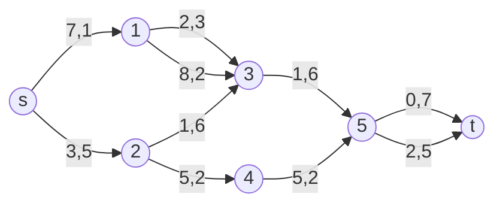
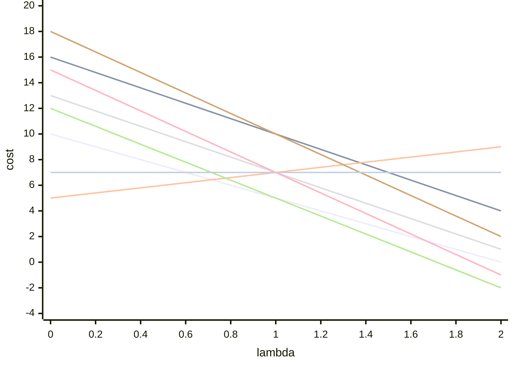

# Example 2

We'll use the following example in which edges are annotated with $(weight,delay)$ pairs and the delay constraint limit we use is $D = 22$:

The chart below plots all 8 paths in the ($\lambda$, $c_{\lambda}$) space.

The convex hull consists of 5 paths: least delay paths 6 $(18,14)$ and 8 $(15,14)$, the shortest weight path 3 $(5,24)$ and two intermediate paths 5 $(12,15)$ and 1 $(10,17)$. The optimal $\lambda$ is 0.7143 with lower bound 6.429. The optimal path $(7,22)$ is not on the convex hull and will not be attained as minimal path of any $\lambda$. There is a duality gap of $(7 - 6.429) / 7 = 0.08157$

## No tie- or tie-breaking

### No tie-breaking

There are two least delay paths with delay $14$: path 6 with weight $18$ and path 8 with weight $15$. Non-tie-breaking LARAC (algorithm `kelley`) picks whichever path comes first. In our case that is path 6. The first iteration intersects this with the shortest weight path 3 $(5,24)$. This gives $\lambda = (5 - 18)/(14 - 24) = 1.3$.

The shortest cost path for $\lambda = 1.3$ is path 5 $(12,15)$. So we update the delay path to path 5 and recompute lambda with paths 3 and 5: $\lambda = (5 - 12)/(15 - 24) = 0.7778$.

Shortest cost path calculation with $\lambda = 0.7778$ yields path 1 $(10,17)$. Again, this is a feasible path, so we update the delay path and cross it with the weight path 3 to obtain $\lambda = (5 - 10)/(17 - 24) = 0.7143$, the optimal value.

### Tie-breaking

With tie-breaking, the delay path is always initialized with the least weight path among all equal delays. This is path 8 with weight $15$ and delay $14$. The first iteration intersects this with the shortest weight path 3 $(5,24)$. This gives $\lambda = (5 - 15)/(14 - 24) = 1$.

With $\lambda = 1$ there is again a tie: both paths 5 $(12,15)$ and 1 $(10,17)$ have the same $c_{\lambda} = 27$ cost. Since both are feasible paths, tie breaking selects the least weight path 1 $(10,17)$ among these two. After updating the delay path with it and crossing it with the weight path 3, we obtain $\lambda = (5 - 10)/(17 - 24) = 0.7143$, the optimal value.

Thus $\lambda$ converged in 2 $\lambda$ calculations with tie-breaking; whereas without tie-breaking it needed 3 $\lambda$ calculations.
