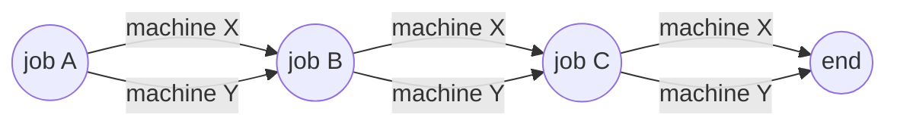

# Motivation

## Abstract

Many combinatorial optimization problems can be modeled as many-to-one assignment decisions with additional feasibility constraints: jobs to machines, teachers to classes, drivers to rides, tasks to employees. Such problems admit a layered DAG or Multi-valued Decision Diagram (MDD) representation, where each layer corresponds to one assignment decision and each source-to-terminal path encodes a complete assignment solution. This structure is expressive, but it comes with two difficulties: exact MDD compilation can grow exponentially in size, and constrained shortest path (CSP) methods may enumerate exponentially many labels or paths. This project explores the middle ground: using layered DAGs and MDDs as compact structural models while leveraging CSP algorithms, MDD-based preprocessing, and decomposition techniques to handle side constraints. A particularly challenging target is the Benders master problem, where assignment decisions must be re-optimized across iterations while the constraint set keeps growing.

## 1. Assignment problems as layered decision structures

Consider the classic 0/1 integer programming formulation of a many-to-one assignment problem: binary variables $x_{ij}$ indicate whether item $i$ is assigned to option $j$, subject to constraints of the form

$$
\sum_{j} x_{ij} = 1 \quad \forall i,
$$

plus possibly additional side constraints over subsets of these variables.

This structure maps naturally onto an MDD. Each layer corresponds to one decision entity (item $i$), and each node has one outgoing arc per alternative (option $j$). Since a path from source to terminal passes through every layer exactly once, it selects exactly one outgoing arc per layer — the exactly-one constraint $\sum_j x_{ij} = 1$ is enforced *by construction*, not by explicit constraints. Every path in the full diagram is a feasible many-to-one assignment, and if arc costs are linear in the assignment variables, a shortest path is a minimum-cost assignment.

## 2. Why additional constraints matter

The appeal of the MDD view is that it gives a compact graph-theoretic account of a broad class of problems. Real instances, however, rarely involve only the assignment constraint. Compatibility rules, precedence relations ("job A must follow job B"), temporal and capacity limits ("machines run at most $x$ hours, all jobs within $y$"), or pairwise interaction costs ("transportation cost if two jobs land on different machines") must be enforced as well.

There are two classical ways to incorporate such constraints into an MDD:

- **Compilation / separation**: transform the diagram — by splitting nodes and removing arcs — so that infeasible paths disappear. Exact compilation encodes the full feasible set, but its size can explode exponentially, quickly becoming impractical even for medium-scale problems.
- **Relaxation**: build a superset diagram that prunes provably infeasible states while remaining polynomial in size, at the cost of retaining some infeasible paths.

## 3. Constrained shortest paths on layered DAGs

An alternative is to leave the assignment diagram intact and instead solve a Constrained Shortest Path problem on it. The MDD then serves as the domain of candidate assignments, and resource constraints are enforced *along paths* rather than by exhaustively restructuring the graph. This connects directly to the CSP literature. CSP is NP-hard, and label-setting or path-ranking techniques may still enumerate exponentially many labels or paths in the worst case.

The question posed in this research is whether these two difficulty profiles can be complementary. Instances that are hard for exact MDD compilation may be easy for CSP, and vice versa: structures that blow up CSP enumeration may yield to MDD-based preprocessing or relaxed filtering. This suggests viewing MDD and CSP techniques not as competitors but as orthogonal tools acting on the same combinatorial structure — MDD methods providing domain reduction and relaxation-based filtering, CSP methods handling the residual feasibility and optimization on the reduced graph.

This is the first research thread of this project. We are currently investigating **completion-equivalence pruning**, an exact compilation technique that we believe illustrates the kind of insight CSP can borrow from the MDD world.

## 4. Benders decomposition and repeated constraint generation

When the problem is even more difficult: other variables are involved than the binary $x_{ij}$ assignments variables (like in MILP). The same assignment structure may still appear as the master problem in a Benders decomposition of such problem. The problem then splits into:

- a **master problem**: a 0/1 assignment problem (the $\sum_j x_{ij} = 1$ constraints, plus cuts and constraints involving the $x_{ij}$ variables), and
- a **subproblem**: given an assignment, decide whether the remaining constraints are feasible and, if so, compute the resulting cost. Violations produce feasibility cuts and feasible solutions produce optimality cuts. Both are added to the master.

Typical examples: once jobs are assigned to machines, subproblem checks might verify machine hour limits and job deadlines, or compute transportation costs incurred when related jobs are split across machines.

The master problem is thus not static: new constraints and cuts arrive at every Benders iteration, and the assignment must be re-optimized with an ever-growing constraint set. A central question is whether we can **avoid resolving from scratch at each iteration** — whether structure, filtering decisions, and solution states from previous iterations can be reused when only a few new cuts arrive.

Here lies the biggest obstacle. Current CSP solvers handle only a handful of resources/constraints effectively, yet Benders convergence may require *many* cuts. The sheer number of constraints is the core scalability challenge, and it is the long-term target of this research.

## 5. Research objectives

In summary, this project aims to:

1. Reconcile MDD compilation/separation techniques with constrained shortest path solvers on layered DAGs — e.g., exact compilation insights (such as completion-equivalence pruning) and relaxed compilation used as stronger preprocessing for CSP.
2. Exploit the complementarity of the two approaches, so that the combined method succeeds on instance classes where pure MDD compilation or pure CSP alone fails.
3. Tackle the Benders master problem with CSP + MDD techniques, with a focus on incremental, warm-started resolution as constraints accumulate across iterations.

The long-term goal is to make these methods effective on broader classes of instances than either approach can handle alone.
