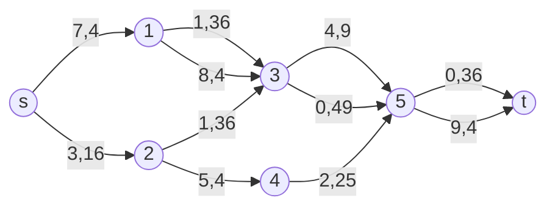

# Documentation

This folder contains the formal problem definitions and algorithm documentation for the constrained shortest path work in this repository, as well as some implementation details as far as required to interpret the results and the scope correctly. It does not document the code, its API or how to use or integrate the code.

## Intent

This documentation is intended for readers familiar with shortest path problems. It provides an overview of the original work that is being developed in this repository. It is not intended as an introduction to the problem or a state-of-the-art survey.

## Problem statement and terminology

The research focuses on the constrained shortest path problem (CSP), where the objective is to find a minimum weight path from a source node $s$ to a terminal node $t$ while satisfying one or more side constraints.

Beside *weights* - the objective value-, each edge is associated with one or more scalars - the constraint values. The optimal path may not exceed a threshold on the sum of each of these scalars. For one constraint, the constraint dimension is called the *delay* of the path, as in the delay-constrained least-cost (DCLC) problem. This problem is also known as the restricted shortest path problem or the  weight constrained shortest path problem (WCSPP). Note the ambiguity with the latter: in our terminology, weight is the objective function to minimize and delay the constraint.

$$
\begin{align}
&min_{p \in G}\ w(p_{s \rightarrow t})\\
&s.t.\ d(p_{s \rightarrow t})\ \leq\ D
\end{align}
$$

The weight and delay of a path are defined as the sum of the weight respectively delay of the edges constituting the path. The codebase works with non-negative integers for weight and delay.

Current focus is on one constraint (DCSP) on layered acyclic multi-digraphs (DAG). In such graphs, nodes are partitioned in layers and edges only connect nodes from layer $L$ to layer $L+1$. The top layer consists of only the source node and the bottom layer has only the terminal node. Such specific layered DAGs are a weighted extension of Decision Diagrams (DD) [Hooker, 2013] and may be constructed from the state-transition graph of recursive dynamic programming formulations [Bergman et al. 2021]. Read about our [motivation](Motivation.md) to use layered DAGs.

Where applicable, the code exploits the layered structure for better performance, smaller memory or simplicity. Unless specified, it is however not required for correctness of the algorithms. All algorithmic ideas extend to general DAGs when layer-by-layer traversal is replaced by topological ordering.

### Example

Example with 5 layers: layer 0 (source s), layer 1 (1,2), layer 2 (3,4), layer 3 (5) and layer 4 (terminal t). Edges are annotated with (weight,delay).

## Solution strategies

Solution strategies used in this research are classified as: Lagrangian relaxation, label setting or path ranking.

### Lagrangian relaxation

[Lagrangian relaxation](CSP/Lagrange-Dual.md) relaxes the bi- or multi dimensional constrained problem into a single cost function by applying a multiplier λ to each constraint.

$$
\begin{align}
c_{\lambda}(e_{vu}) = w(e_{vu}) + \lambda \cdot d(e_{vu})
\end{align}
$$

For any non-negative value of the multiplier $\lambda$, the constrained shortest path is thus relaxed to a simple one dimensional shortest path problem in cost $c_{\lambda}$ that can be easily solved for fixed values of $\lambda$. The solution of this relaxed shortest path problem gives a lower bound on the optimum of the original constrained shortest path problem. The problem of finding the highest lower bound is the Lagrange dual problem. Solving the Lagrange dual does not mean finding the optimal path of the original constrained shortest path problem: the path may evade the algorithm or there may exist a duality gap. Hence this technique is not an exact solver.

The multiplier λ is used to guide other techniques like label setting or path ranking. This often makes these exact methods converge much faster. Hence the Lagrange dual problem is solved as input to other exact solvers.

### Label setting

[Label setting](CSP/Labeling.md) methods construct partial paths from the source and maintain a label that summarizes the current state. A label typically stores information such as cumulative weight, cumulative delay and the current node, and -if path reconstruction is required- predecessor information.

A label is repeatedly expanded along edges. The ordering in which expansion happens is one of the main differentiators for label setting algorithms. Orderings used in this research are:

- [depth-first ordering](CSP/Labeling-DFS.md)

The efficiency of label setting further depends on pruning rules. Pruning rules fathom labels early if it can be proven the partial path cannot be completed to an optimal path.

### Path ranking

There are currently no path ranking algorithms in this repository.

Path ranking algorithms list paths in increasing order of some cost. This is often done with a k-shortest path algorithm. If the ranking happens in the weight dimension, the algorithm stops at the first -and thus minimal due to the ranking order- feasible path. The ranking can also order paths in Lagrangian cost dimension. In this case, an optimality certificate comes whenever the next shortest cost path's Lagrangian cost equals or exceeds the incumbent.

## Contributions

The main methodological contributions currently explored are as follows.
We are unaware of prior publications describing these specific contributions.

### DFS label-setting

We propose two new pruning rules that are used in label setting with a depth first exploration:

- **Backward dominance pruning**: computed after successor exploration and before backtracking. Achieves stronger pruning by leveraging dominating labels at successor nodes rather than the incoming label.
- **Completion equivalence pruning**: partitions the delay space at each node into intervals sharing the same optimal completion weight. Labels falling within the same interval can be fathomed.

## Benchmarking

The different solvers are benchmarked on randomly generated graphs and input data. Results will be shared on the [Benchmarks](CSP/Benchmarks.md) page. The [benchmark/](../benchmarks/) directory explains the benchmark applications, their configuration, data generation and output.

## Documentation structure

- [`CSP/`](CSP/) — documentation for the constrained shortest path problem
  - [`Benchmarks.md`](CSP/Benchmarks.md) summarizes results, comparing the different solvers
  - [`Labeling.md`](CSP/Labeling.md) describes label setting
  - [`Labeling-DFS.md`](CSP/Labeling-DFS.md) describes specifically the depth first variants of label setting and our contributions to it
  - [`Lagrange-Dual.md`](CSP/Lagrange-Dual.md) describes solving the dual problem
  - [`examples/`](CSP/examples/) — contains examples demonstrating the algorithmic ideas on example problems
- [`Motivation.md`](Motivation.md) describes the context of this research and constrained shortest paths on layered acyclic digraphs

## References

Bergman D., Bodur M., Cardonha C., Cire A.A. (2021). Network Models for Multiobjective Discrete Optimization. INFORMS Journal on Computing Vol. 34, No. 2. [doi: 10.1287/ijoc.2021.1066](https://doi.org/10.1287/ijoc.2021.1066)

Hooker, J.N. (2013). Decision Diagrams and Dynamic Programming. In: Gomes, C., Sellmann, M. (eds) Integration of AI and OR Techniques in Constraint Programming for Combinatorial Optimization Problems. CPAIOR 2013. Lecture Notes in Computer Science, vol 7874. Springer, Berlin, Heidelberg. [doi: 10.1007/978-3-642-38171-3_7](https://doi.org/10.1007/978-3-642-38171-3_7)
