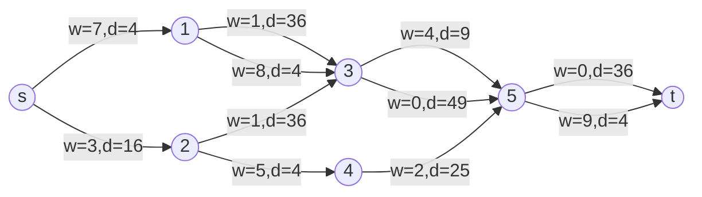

# Documentation

This folder contains the formal problem definitions and algorithm documentation for the constrained shortest path work in this repository. As well as some implementation details as far as required to interpret the results and the scope correctly. It is not a documentation of the code, its API or how to use or integrate the code. 

## Intent

This documentation is intended for readers familiar with shortest path problems. It provides an overview of the original work that is being developed in this repository. It is not intended as an introduction to the problem or a state-of-the-art survey.

## Problem statement and terminology

The research focuses on the constrained shortest path problem (CSP), where the objective is to find a minimum weight path from a source node $s$ to a terminal node $t$ while satisfying one or more side constraints.

Beside *weights* - the objective value-, each edge is associated with one or more scalars - the constraint values. The optimal path may not exceed a threshold on the sum of each of these scalars. For one constraint, the constraint dimension is called the *delay* of the path, as in the delay constrained least cost (DCLC) problem. This problem is also known as the restricted shortest path problem or the  weight constrained shortest path problem (WCSPP). Note the ambiguity with the latter: in our terminology, weight is the objective function to minimize and delay the constraint. 

$$
\begin{align}
&min_{p \in G}\ w(p_{s \rightarrow t})\\
&s.t.\ d(p_{s \rightarrow t})\ \leq\ D
\end{align}
$$

The weight and delay of a path are supposed to be the sum of the weight respectively delay of the edges constituting the path. The codebase works with none-negative integers for weight and delay.

Current focus is on one constraint (DCLC) on layered acyclic multi-digraphs (DAG). In such graphs, nodes are partitioned in layers and edges only connect nodes from layer $L$ to layer $L+1$. The top layer consists of only the source node and the bottom layer has only the terminal node. Such specific layered DAGs are a weighted extension of Decision Diagrams (DD) [Hooker, 2013] and may be constructed from the state-transition graph of recursive dynamic programming formulations [Bergman et al. 2021]. [Read more](Motivation.md) about our motivation to use layered DAGs.

Where applicable, the code exploits the layered structure for better performance, smaller memory or simplicity. Unless specified, it is however not required for correctness of the algorithms. All algorithmic ideas extend to general DAGs when layer-by-layer traversal is replaced by topological ordering.

*Example with 6 layers: layer 1 (source), layer 2 (1,2), layer 3 (3,4), layer 5 (5) and layer 6 (terminal) .*

## Solution strategies

Solution strategies used in this research can be classified under the label setting or dynamic programming category.

### Label setting 

[Label setting](CSP/Labeling.md) methods construct partial paths from the source and maintain a label that summarizes the current state. A label typically stores information such as cumulative weight, cumulative delay and the current node, and -if path reconstruction is required- predecessor information.

A label is repeatedly expanded along edges. The ordering in which expansion happens is one of the main differentiators for label setting algorithms. Orderings used in this research are:

 - [depth-first ordering](CSP/Labeling-DFS.md)

The efficiency of label setting further depends on pruning rules. Pruning rules fathom labels early if it can be proven the partial path can not be completed to an optimal path. [Read more](CSP/Labeling.md) about this repositories research into label setting solution strategies.

## Contributions

The main methodological contributions currently explored are as follows.
We are unaware of prior publications describing these specific  contributrions.

###  DFS label-setting

We propose two new pruning rules that are used in label setting with a depth first exploration:

- **Backwards dominance pruning**: computed after successor exploration and before backtracking. Achieves stronger pruning by leveraging dominating labels at successor nodes rather than the incoming label.
- **Completion equivalence pruning**: partitions the delay space at each node into intervals sharing the same optimal completion weight. Labels falling within the same interval can be fathomed.

## Documentation structure

- `CSP/` — documentation for the constrained shortest path problem
	- [`Labeling.md`](CSP/Labeling.md) describes label setting
	- [`Labeling-DFS.md`](CSP/Labeling-DFS.md) describes specifically the depth first variants of label setting and our contributions to it

## References

Bergman D., Bodur M., Cardonha C., Cire A.A. (2021). Network Models for Multiobjective Discrete Optimization. INFORMS Journal on Computing Vol. 34, No. 2 https://doi.org/10.1287/ijoc.2021.1066

Hooker, J.N. (2013). Decision Diagrams and Dynamic Programming. In: Gomes, C., Sellmann, M. (eds) Integration of AI and OR Techniques in Constraint Programming for Combinatorial Optimization Problems. CPAIOR 2013. Lecture Notes in Computer Science, vol 7874. Springer, Berlin, Heidelberg. https://doi.org/10.1007/978-3-642-38171-3_7
 
